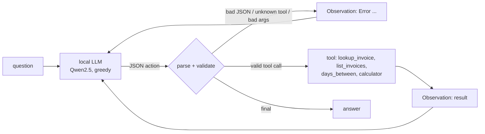
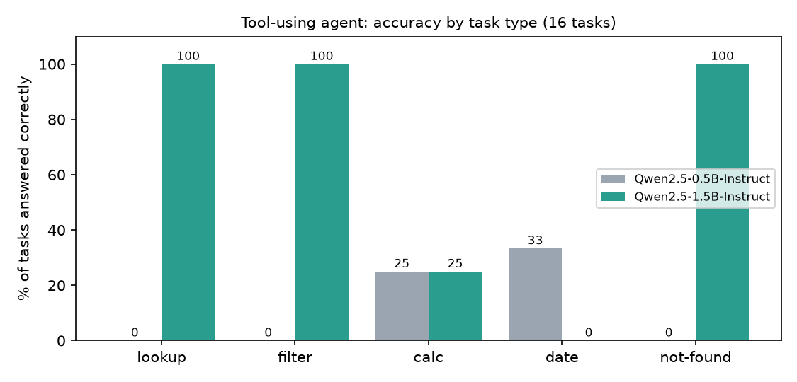

# A Small Tool-Using Agent, Built From Scratch and Measured

A minimal AI agent in about 200 lines of plain Python (loop plus tools): no agent framework, no API keys, runs on a laptop CPU with an open model. It answers questions about a set of invoices by calling tools (record lookup, filtering, a safe calculator, date arithmetic), and it is evaluated on 16 tasks with deterministic checks.

The point is the loop and the measurement, not the model. Every step is visible, and failures are recorded rather than hidden.



## How it works

- **Protocol.** The model replies with one JSON object per turn: `{"action": "<tool>", "args": {...}}` or `{"action": "final", "answer": "..."}`. The system prompt lists the tools and shows one worked example.
- **The loop** (`src/agent.py`) parses the reply, checks the tool name and its arguments against the real function signature, runs the tool, and appends the result as an `Observation:`. It stops on a final answer or after `max_steps`.
- **Errors are observations.** Malformed JSON, an unknown tool, wrong arguments, or a tool error (for example "no invoice with id INV-9") go back to the model so it can correct itself. They are counted, so error rates are measurable.
- **Small-model guard.** If a model writes its own `Observation:` line (small models do), the reply is cut there so invented tool output never enters the context.
- **Safe tools.** The calculator walks the AST and allows only numbers and `+ - * /`; it never calls `eval`. Tests check that code-injection attempts are rejected.
- **Pluggable model.** The agent only needs `chat(messages) -> str`, so tests use a scripted fake and the same loop runs against any backend.

## Results

16 tasks over a 10-invoice dataset, greedy decoding, scored by deterministic checks (`src/scoring.py`). Ground truth is computed from the data (`src/tasks.py`), so expected answers cannot drift.

| Model | Correct answers | Used the expected tools | Finished with an answer | Avg errors / task |
|---|---|---|---|---|
| Qwen2.5-0.5B-Instruct | 12% (2/16) | 25% | 88% | 2.1 |
| **Qwen2.5-1.5B-Instruct** | **62% (10/16)** | 62% | 100% | 0.4 |



| Task type | 0.5B | 1.5B |
|---|---|---|
| lookup (n=4) | 0% | **100%** |
| filter / count (n=3) | 0% | **100%** |
| not-found, should say so (n=2) | 0% | **100%** |
| calculation (n=4) | 25% | 25% |
| date arithmetic (n=3) | 33% | 0% |

Full per-task table: [`results/RESULTS.md`](results/RESULTS.md). Every step of every run (model output, tool observation) is in `results/agent.*.json`.

## What the failures show

The 1.5B model is reliable on single-tool tasks and weak on anything that needs a chain of steps. I read every failing trace:

1. **It invents arguments instead of taking them from the question.** On the three date questions it never looked up the invoice's due date. It called `list_invoices` with a customer name that appears nowhere in the question ("XYZ Corp"), then called `days_between` with the same date twice, got `0`, and answered "not yet due" or "due today". On t10 it filtered by that invented customer, got an empty list, and concluded there are no invoices.
2. **It stops one step early.** On "average of the paid invoices" it summed the four amounts correctly and then reported the sum as the average, skipping the division.
3. **My prompt leaked into an answer.** The calculator's description in the prompt includes the example `'2300 * 0.15 + 12'`. On the late-fee task the model computed `2300.0 * 0.15 + 12.0` and answered $357 instead of $345. That is a defect in my prompt, not only a model weakness. I left it unfixed so the reported numbers match the code in this repo; fixing it is item 1 under "Next steps".
4. **It handles "this does not exist" well.** Both unknown-invoice questions got a correct "no invoice with that ID" answer, which is the behaviour that matters most for a data-lookup agent: no guessed values.
5. **The 0.5B model is not usable as an agent.** It often answers in plain prose instead of JSON (so the loop sends it an error and it retries), invented an "error receiving the response" message, and answered "0.00 USD" for an invoice that does not exist. Its 2 correct answers are not reliable: one date answer (t13) was right by coincidence, because it passed an invented date and happened to get 7 days.

Takeaway: a tool-calling loop with validation and error feedback is enough to make a 1.5B model dependable on simple lookups. Multi-step reasoning is where model size shows, and the usual fixes are a stronger model, better prompts, or constraining the output format (see below).

## Run it

```bash
python -m venv .venv && source .venv/bin/activate        # Windows: .venv\Scripts\activate
pip install -r requirements.txt -r requirements-ci.txt
pytest -q                                                 # 22 tests, no model needed (the loop is tested with a scripted fake model)
python -m src.run "How many invoices are currently open?" # needs a one-time model download (about 3 GB for the 1.5B model)
bash scripts/run_eval.sh                                  # both models on all 16 tasks, then the report (about 25 min on a 4-core CPU)
```

Environment note: on Windows with an older VC++ runtime, current PyTorch wheels may fail to load. Pinning `torch==2.6.0` and `transformers<5` worked here.

## Limitations (read before quoting the numbers)

- **Tiny evaluation.** 16 tasks, one run each. One task is 6 percentage points, so treat 62% as "roughly half to three-quarters", and the 25%/0%/33% cells (n=3-4) as anecdotes.
- **Synthetic data.** 10 invoices I wrote. Real data is larger and messier.
- **A single prompt, not tuned.** I did not iterate on the prompt after seeing results (unlike my RAG project, where I report both versions). That is why the leaked `+ 12` is still in the numbers.
- **Greedy, single sample.** No repeated runs, so no measure of run-to-run variation.
- **The tool-use metric is approximate.** "Used the expected tools" requires specific tools per task; a valid alternative route would be marked down.
- **The "after 8 steps" cap and the 120-token reply cap are arbitrary.**
- **Timing is rough.** The laptop was also doing other work.

## Next steps

1. Remove the example from the calculator's description and re-run, reporting both versions.
2. Constrain decoding to the JSON schema (grammar-constrained generation), which removes the prose-instead-of-JSON failure at its source.
3. Add a `get_today` tool so the model does not need dates spelled out, and a "plan first" prompt for multi-step questions.
4. Try a larger model (or an API model behind the same `chat()` interface) and compare on the same 16 tasks; expand to a few hundred tasks.
5. Wrap it in a FastAPI service and deploy it through the Azure pipeline from my other project.

## Layout

```
src/agent.py     the loop: parse, validate, call tool, observe
src/tools.py     lookup_invoice, list_invoices, days_between, calculator (AST-based)
src/llm.py       LocalChatModel (Hugging Face) and ScriptedLLM (for tests)
src/tasks.py     16 evaluation tasks, ground truth computed from the data
src/scoring.py   deterministic answer checks
src/evaluate.py  run all tasks, write results/agent.<model>.json
src/report.py    results/RESULTS.md and the chart
tests/           22 tests (loop recovery, tool safety, scorer edge cases, task-file freshness)
```

Related projects: [azure-cicd-showcase](https://github.com/Sup3rMar10/azure-cicd-showcase), [llm-finetune-invoice-extraction](https://github.com/Sup3rMar10/llm-finetune-invoice-extraction), [rag-docs-qa-eval](https://github.com/Sup3rMar10/rag-docs-qa-eval).
